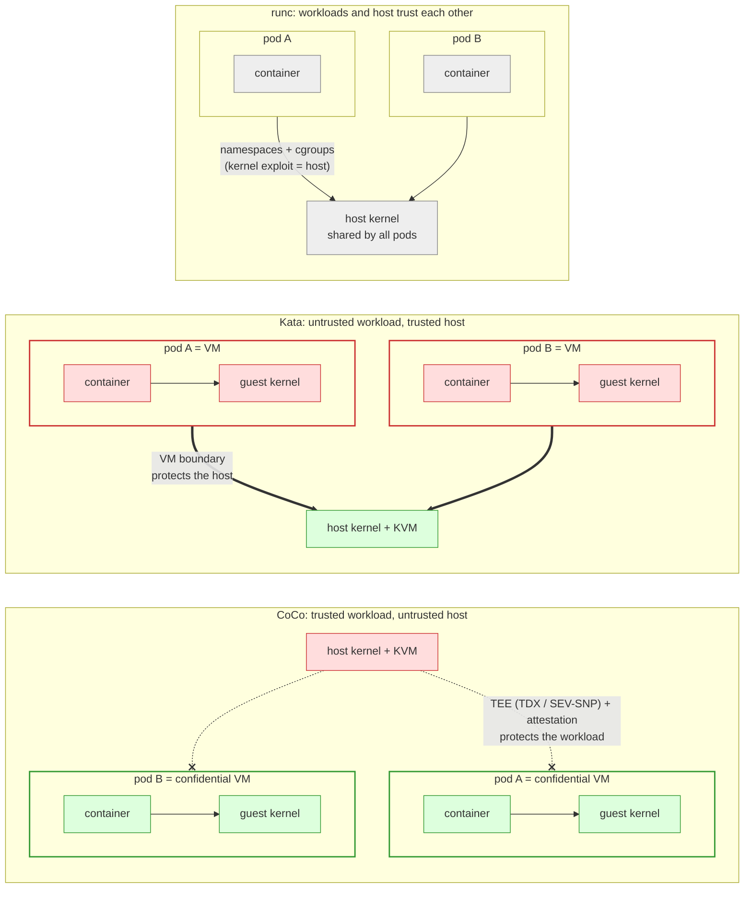
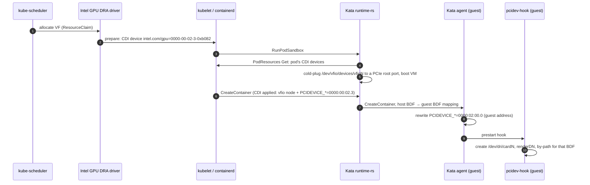

# Kata Containers: sandboxed containers with Intel GPUs using DRA

---

## 1. Recap: Kata Containers and RuntimeClasses

- Kata Containers runs each pod in its own lightweight VM with its own guest
  kernel. It looks like a normal container to Kubernetes, but has VM isolation.
- A pod selects the runtime with `runtimeClassName`. The RuntimeClass maps to a
  containerd runtime handler (`kata-qemu-runtime-rs`). Pods without it keep
  using runc.
- runtime-rs is the Rust shim and the default since Kata 4.0.

```yaml
apiVersion: node.k8s.io/v1
kind: RuntimeClass
metadata:
  name: kata
handler: kata-qemu-runtime-rs
---
spec:
  runtimeClassName: kata   # in the pod spec
```

### Isolation models



Red is untrusted, green is trusted. In Kata, the VM boundary keeps an untrusted
workload (for example an AI agent running generated code) away from the host and
the other pods. CoCo turns this around: the TEE keeps the host away from the
workload.

| | runc | Kata | Confidential Containers |
|---|---|---|---|
| Kernel | shared host kernel | guest kernel per pod | guest kernel per pod, in a TEE |
| Protects | none: a kernel exploit reaches the host and other pods | the host and other pods from an untrusted workload (AI agents, user code) | the workload from an untrusted host or cloud operator |
| Trust boundary | the container | the pod VM | the pod VM plus attestation |
| GPU | host driver, device nodes | VF passed through to the VM, guest driver | the same, plus TEE-capable devices (future) |

---

## 2. How it works

The GPU is split into SR-IOV VFs. Each pod VM gets whole VFs through VFIO, and
the `xe` driver runs in the guest.



### Why `PCIDEVICE_*` matters

- The host VF address (`0000:00:02.3`) means nothing inside the VM, where the
  VF shows up at a different address (`0000:02:00.0`).
- The Kata agent translates the host addresses in `PCIDEVICE_*` environment
  variables to guest addresses. This is the only standard channel that tells
  the container which device is its own.
- `pcidev-hook` uses the translated address to create exactly that VF's
  `/dev/dri` nodes in the container, with no `-v /dev:/dev`.
- 4.3.0 fixed the translation on container create and for several devices per
  container (#13935).
- Each device needs its own variable name in the CDI spec. CDI edits for the
  same name overwrite each other.

---

## 3. Bill of materials

| Component | Source | Customized? |
|---|---|---|
| Kubernetes 1.37 with containerd 2.x | upstream | no |
| Intel GPU DRA driver and xpumd | upstream | no (claim restricted to VFs with a selector) |
| Host: SR-IOV VFs bound to `vfio-pci`, iommufd (`/dev/vfio/devices/vfioN`) | host setup | init script |
| Kata 4.3.0 via the kata-deploy helm chart, `qemu-runtime-rs` only | release | no |
| Guest kernel with Intel Xe (`build-kernel.sh -g intel`) | 4.3.0 source | **built** (not shipped in releases) |
| Guest rootfs image plus `pcidev-hook` | 4.3.0 image | **modified** |
| CDI spec: `vfioN` node and a unique `PCIDEVICE_*` per VF, in `/var/run/cdi` | hand-written | **custom** (overrides the DRA driver's spec) |
| runtime-rs drop-in `config.d/50-intel-xe-vf.toml` | hand-written | **custom** |

```toml title="runtime-rs/runtimes/qemu-runtime-rs/config.d/50-intel-xe-vf.toml"
[hypervisor.qemu]
kernel = "/usr/local/share/kata-xe/vmlinux-6.18.56-208-intel-gpu"
image = "/usr/local/share/kata-xe/kata-containers-xe-test.img"
cold_plug_vfio = "root-port"
vm_rootfs_driver = "virtio-blk-pci"
guest_hook_path = "/usr/share/oci/hooks"

[runtime]
pod_resource_api_sock = "/var/lib/kubelet/pod-resources/kubelet.sock"
```

---

## 4. Demos

**Demo 1: 7 pods with 1 VF each** (Deployment, `replicas: 7`)

- 7 VMs, each with one different host VF (`02.1` … `02.7`)
- each guest: kernel `6.18.56-intel-gpu`, `PCIDEVICE_*` = `0000:02:00.0`,
  `card0` and `renderD128`, OpenCL `Intel(R) Graphics [0xb082]`

**Demo 2: 3 pods with 2 VFs each** (ResourceClaimTemplate `count: 2`)

```text
== xe-vf-2x-86d7b876b7-27rb4
kernel: 6.18.56-intel-gpu
  host 0000_00_02_4 -> guest 0000:02:00.0
  host 0000_00_02_5 -> guest 0000:03:00.0
  dri: card0 card1 renderD128 renderD129
  ocl #0: Intel(R) Graphics [0xb082]
  ocl #1: Intel(R) Graphics [0xb082]
```

- 6 different VFs across the 3 pods
- both variables translated, two DRM devices, two OpenCL devices per pod

---

## 5. Road ahead

### Agree on the CDI spec generated for Kata

What the DRA driver generates today:

```yaml
- name: 0000-00-02-3-0xb082
  containerEdits:
    deviceNodes:
      - path: /dev/vfio/22                    # legacy VFIO group
      - path: /dev/vfio/vfio                  # legacy VFIO container
      - path: /dev/vfio/devices/vfio2
```

What Kata needs:

```yaml
- name: 0000-00-02-3-0xb082
  containerEdits:
    deviceNodes:
      - path: /dev/vfio/devices/vfio2         # iommufd cdev only
    env:
      - PCIDEVICE_INTEL_COM_GPU_0000_00_02_3=0000:00:02.3   # unique name per device
```

### Upstream

- runtime-rs: cold-plug DRA devices from PodResources, and fix the CDI
  spec-directory priority (`/var/run/cdi` must override `/etc/cdi`)
- guest device nodes: upstream `pcidev-hook`, or let the agent create the DRM
  nodes itself
- guest kernel with Intel Xe support shipped in Kata releases or in kata-deploy

### Docs

- finalize the Intel Xe SR-IOV guide (Docker) and the Kata PR
- add a Kubernetes and DRA section

### Known gaps

- every VM pins all its memory in `/dev/shm` for VFIO, so N pods need
  N × guest memory there (size with pod memory limits)
- the PF is published as allocatable: restrict VFIO claims to VFs
  (`type == "vf"`) in the DeviceClass
- `vfioN` numbers change when VFs are rebound, so the CDI spec must be
  generated, not static
- guest prestart hooks become poststart hooks when the spec has host or CDI
  hooks
